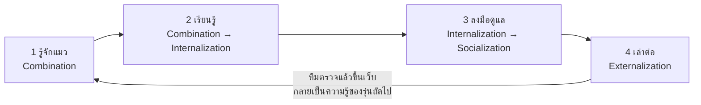
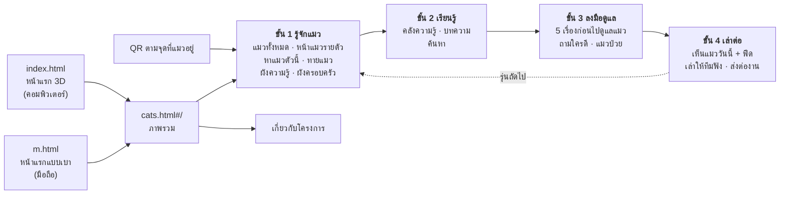
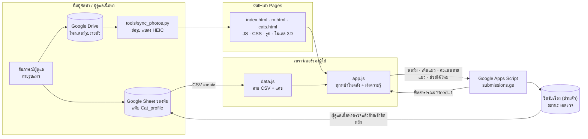
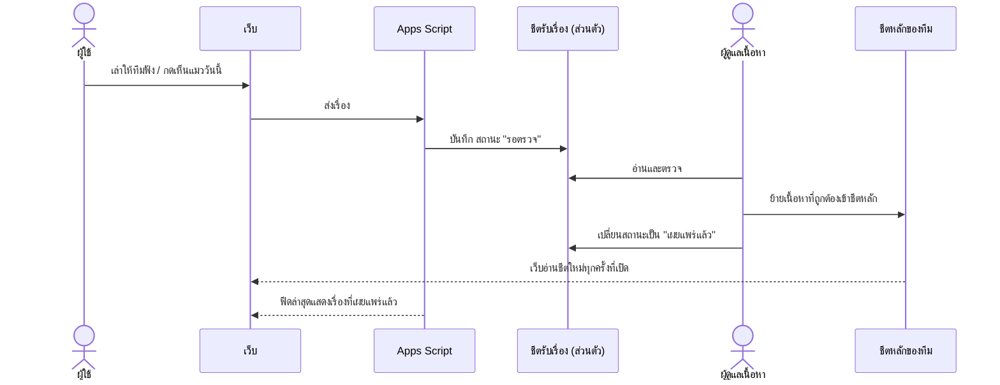

# คลังความรู้แมวอักษร: แนวคิด โครงสร้าง และมุมการจัดการความรู้

เอกสารนี้อธิบายว่าเว็บทำขึ้นเพื่ออะไร ทำไมถึงมีหน้าแต่ละหน้า ใช้เทคโนโลยีอะไร และแต่ละส่วนตอบทฤษฎีการจัดการความรู้ (KM) ข้อไหน ใช้เป็นวัตถุดิบสำหรับสไลด์และรายงานได้เลย ท้ายเอกสารมีโครงสไลด์ที่แนะนำกับรายการอ้างอิง

- เว็บจริง: https://pheechan.github.io/aksorn-cat-hub/
- โค้ด: https://github.com/pheechan/aksorn-cat-hub
- วิธีดูแลเว็บและกรอกชีต: [README.md](../README.md)
- ตัวเลขในเอกสารนี้นับ ณ วันที่ 11 พ.ย. 2569 (แมว 18 ตัว แมวประจำคณะ 7 ตัว บทความ 8 เรื่อง)

---

## 1. สรุปในย่อหน้าเดียว

เรื่องแมวในคณะอักษรฯ มีคนรู้อยู่แล้ว แต่ความรู้นั้นอยู่ในหัวพี่แม่บ้านกับผู้ดูแลไม่กี่คน และกระจายอยู่ในแชตหลายกลุ่ม นิสิตที่มาช่วยดูแลก็เปลี่ยนรุ่นทุกปี พอเรียนจบ สิ่งที่รู้ก็หายไปด้วย มือใหม่จึงต้องเริ่มจากศูนย์ทุกปี ไม่รู้ว่าแมวตัวไหนชื่ออะไร ตัวไหนทำหมันแล้ว ตัวไหนไม่ชอบให้จับ หรือแมวป่วยต้องบอกใคร เว็บนี้รวมความรู้เหล่านั้นไว้ที่เดียว โดยเฉพาะ **ความรู้โดยนัย (tacit knowledge) ของผู้ดูแล** ที่ได้จากการสัมภาษณ์ จัดเป็นเส้นทาง 4 ขั้นให้มือใหม่เดินตาม (รู้จักแมว → เรียนรู้ → ลงมือดูแล → เล่าต่อ) และเปิดให้ทุกคนส่งเรื่องกลับเข้ามา ทีมตรวจก่อนเผยแพร่ ขั้นสุดท้ายของคนรุ่นนี้จึงกลายเป็นขั้นแรกของรุ่นถัดไป

---

## 2. ปัญหาที่เว็บตั้งใจแก้

| ปัญหา | เกิดอะไรขึ้นจริง | มุม KM |
|---|---|---|
| ความรู้อยู่ในตัวคน | วิธีเข้าหาแมวแต่ละตัว ตัวไหนป่วยบ่อย ตัวไหนไม่ถูกกัน รู้กันแค่ผู้ดูแลไม่กี่คน | ความรู้โดยนัย (Polanyi, 1966) |
| ความรู้หายตามรุ่น | นิสิตที่ช่วยดูแลจบไปทุกปี ไม่มีอะไรส่งต่อเป็นระบบ | การสูญเสียความรู้จากการหมุนเวียนคน (DeLong, 2004) |
| ข้อมูลกระจัดกระจาย | รูปอยู่ใน IG ข้อมูลอยู่ในชีต เรื่องเล่าอยู่ในแชต | ขาดคลังกลางและการจัดระเบียบ |
| มือใหม่ไม่รู้จะเริ่มตรงไหน | ไม่รู้ชื่อแมว ไม่รู้ว่าตัวไหนทำหมันแล้ว ไม่รู้ว่าแมวป่วยต้องบอกใคร | ความรู้ไม่ถึงมือคนที่ต้องใช้ |
| ไม่มีใครรู้ว่าข้อมูลยังถูกอยู่ไหม | ข้อมูลแมวเปลี่ยนตลอด (หาย ย้าย ป่วย มีคนรับไป) | ขาดการตรวจสอบและทบทวนความรู้ |

**ต่างจากที่มีอยู่แล้วยังไง** แอปแผนที่แมวจรทั่วไปอย่าง JohnJud Map บอกว่าแมวอยู่ตรงไหน แต่ไม่ได้เก็บสิ่งที่ผู้ดูแลรู้เกี่ยวกับแมวแต่ละตัว และไม่ได้ออกแบบมาให้ชุมชนหนึ่งส่งต่อความรู้ข้ามรุ่น จุดต่างของเราคือความรู้จากผู้ดูแลในคณะ กับระบบส่งต่อให้รุ่นถัดไป

---

## 3. ใครใช้เว็บนี้

| กลุ่ม | ต้องการอะไร | หน้าที่ตอบ |
|---|---|---|
| **นิสิตมือใหม่ที่อยากช่วยดูแลแมว** (ผู้ใช้หลัก) | รู้จักแมว รู้ว่าทำอะไรได้ไม่ได้ รู้ว่าต้องถามใคร | เส้นทาง 4 ขั้นทั้งหมด |
| ผู้ดูแลปัจจุบัน (พี่แม่บ้าน นิสิตรุ่นพี่) | มีที่จดสิ่งที่รู้ ไม่ต้องตอบคำถามเดิมซ้ำทุกปี | เล่าต่อ, เล่าให้ทีมฟัง, ถามใครดี |
| คนทั่วไปที่เจอแมว | ตัวนี้ชื่ออะไร เจอแมวป่วยต้องทำยังไง | หาแมว, แมวป่วย, QR หน้าจุดที่แมวอยู่ |
| ทีมดูแลเนื้อหารุ่นถัดไป | รับงานต่อได้โดยไม่ต้องถามคนที่จบไปแล้ว | ส่งต่องาน, เกี่ยวกับโครงการ, README |

---

## 4. แนวคิดหลักในการออกแบบ

### 4.1 เส้นทาง 4 ขั้น = วงจร SECI
เมนู หน้าแรก และแถบเมนูบนมือถือ เรียงตาม 4 ขั้นเดียวกันทั้งเว็บ ทุกหน้าอยู่ในขั้นใดขั้นหนึ่ง และหน้าหลักของแต่ละขั้นจบด้วยการ์ด "ขั้นต่อไป" หน้าภาพรวมจำว่าผู้ใช้ทำขั้นไหนไปแล้ว (เก็บในเครื่องผู้ใช้เอง) แล้วแนะนำขั้นถัดไป

ขั้นที่ 4 ของคนหนึ่งคือขั้นที่ 1 ของมือใหม่รุ่นถัดไป ความรู้จึงวนเป็นเกลียว ไม่ได้ถูกเก็บไว้เฉย ๆ ตรงกับแนวคิด knowledge spiral ของ Nonaka และ Takeuchi (1995)

### 4.2 ทั้งเขียนลงเว็บ และชี้ไปหาคน
Hansen และคณะ (1999) แบ่งกลยุทธ์ KM เป็นสองแบบ เว็บนี้ใช้ทั้งคู่
- **Codification** เขียนสิ่งที่เขียนได้ลงคลัง: ข้อมูลแมวรายตัว บทความ ประวัติการดูแล
- **Personalization** ความรู้บางอย่างเขียนไม่หมด เช่น อ่านอาการแมวจากท่าทาง หน้า "ถามใครดี" จึงบอกว่าเรื่องไหนต้องไปถามใคร และหน้า "5 เรื่องก่อนไปดูแลแมว" จบที่การไปดูแลจริงกับผู้ดูแลรุ่นก่อน

### 4.3 Google Sheet คือระบบจัดการเนื้อหา
ทีมแก้ข้อมูลในชีต แล้วเว็บอัปเดตเองภายในไม่กี่นาที ไม่ต้องแก้โค้ด เหตุผลคือความยั่งยืน: คนที่ดูแลเว็บรุ่นถัดไปอาจเขียนโค้ดไม่เป็น แต่ทุกคนกรอกชีตได้ ระบบจึงไม่พังเมื่อคนทำเว็บเรียนจบ

### 4.4 ทุกความรู้มีที่มาและสถานะ
บทความกับข้อมูลแมวบอกว่ามาจากไหน (สัมภาษณ์ใคร เมื่อไร) ใครตรวจทาน และตรวจล่าสุดเมื่อไร ถ้าเกิน 120 วัน เว็บขึ้นป้ายเตือนเองว่าข้อมูลอาจเก่า แมวที่ไม่มีใครเห็นนานก็ขึ้นข้อความชวนคนที่เห็นให้ช่วยบอก เรื่องที่คนนอกส่งเข้ามามีสถานะ "รอตรวจ" ก่อนเสมอ

### 4.5 ความเป็นส่วนตัวและจริยธรรม
- ชื่อผู้ดูแลยังไม่แสดงบนเว็บจนกว่าเจ้าของชื่อจะอนุญาต ระหว่างนี้เว็บบอกเป็นตำแหน่งกับที่ที่หาตัวได้แทน
- เรื่องที่ส่งเข้ามามีชื่อและช่องทางติดต่อ จึงเก็บในชีตส่วนตัวแยกจากชีตข้อมูลแมว
- ฟีดสาธารณะแสดงแค่ชื่อแมวกับเวลา ชื่อผู้ส่งขึ้นเฉพาะคนที่กดอนุญาต
- ไม่ระบุตำแหน่งลูกแมวแรกเกิดละเอียดเกินไป

### 4.6 ใช้ที่หน้างานได้ด้วยมือถือ
คนส่วนใหญ่เปิดเว็บตอนยืนอยู่หน้าแมว มือถือจึงมีหน้าแรกแยก (`m.html`) ที่เบากว่า ติดตั้งเว็บเป็นแอปได้ เปิดหน้าที่เคยเปิดแล้วได้แม้ไม่มีสัญญาณ และมี QR ติดที่จุดที่แมวอยู่เพื่อเปิดหน้าแมวตัวนั้นทันที

---

## 5. ทำไมถึงมีหน้านี้

### 5.1 แผนผังเว็บ

### 5.2 หน้าทั้งหมด ทำไมต้องมี และตอบ KM ข้อไหน

**ทางเข้า**

| หน้า | ลิงก์ | ทำไมต้องมี | มุม KM |
|---|---|---|---|
| หน้าแรกแบบ 3D | `index.html` | เล่าปัญหาของโครงการเป็นเรื่องราว มีแผนที่ 3D ของคณะ ปักหมุดว่าแมวอยู่ตึกไหน (BRK, MCS, เทวาลัย) ดึงตัวเลขสดจากชีต ใช้เปิดการนำเสนอได้ | ทำให้คนสนใจและเข้าใจว่าทำไมต้องจัดการความรู้เรื่องนี้ |
| หน้าแรกบนมือถือ | `m.html` | มือถือเปิดหน้าแรกแล้วถูกส่งมาที่นี่ คอลัมน์เดียว ไม่มี 3D มีค้นหา แมวในคณะ 4 ขั้น และแมวอยู่ตรงไหน | เข้าถึงความรู้ได้ที่หน้างาน |
| ภาพรวม | `cats.html#/` | จุดเริ่มของคลัง ค้นหารวม คำถามที่เจอบ่อย ความคืบหน้า 4 ขั้น และขั้นที่ควรทำต่อ | เส้นทางการเรียนรู้ (learning path) |
| พิมพ์ QR | `#/qr` | พิมพ์ QR ไปติดที่จุดที่แมวอยู่ สแกนแล้วเปิดหน้าแมวตัวนั้น | ความรู้ ณ จุดที่ต้องใช้ (just-in-time) |

**ขั้น 1 รู้จักแมว** (Combination: รวมความรู้ที่จดไว้แล้วจากหลายแหล่งให้เป็นระบบ)

| หน้า | ลิงก์ | ทำไมต้องมี | มุม KM |
|---|---|---|---|
| แมวทั้งหมด | `#/cats` | ดูแมวทุกตัว กรองได้ตามสถานะ สีขน พื้นที่ และนิสัย แมวประจำคณะมีป้ายกำกับ | การจัดหมวดแบบหลายมิติ (faceted classification) |
| หน้าแมวรายตัว | `#/cat/ชื่อ` | รูป ข้อมูลพื้นฐาน "ปกติแมวตัวนี้เป็นยังไง" วิธีเข้าหา ข้อควรรู้ บันทึกจากการสัมภาษณ์ ประวัติการดูแล บทความที่เกี่ยวข้อง ที่มาของข้อมูล และปุ่ม "เห็นตัวนี้วันนี้" | ความรู้โดยนัยที่ถอดออกมาเป็นตัวหนังสือแล้ว (externalized) พร้อมเมทาดาต้า |
| หาแมวตัวนี้ | `#/find` | เจอแมวแต่ไม่รู้ชื่อ เลือกสีขนกับที่ที่เจอแล้วเว็บช่วยหา | ค้นได้แม้ไม่รู้คำค้น |
| ทายแมว | `#/quiz` | ทายชื่อแมวจากรูป ตัวนี้เข้าหายังไง ทำหมันหรือยัง ส่งคะแนนแบบไม่มีชื่อให้ทีม | Internalization และใช้วัดว่าเว็บช่วยให้จำแมวได้จริงไหม |
| ผังความรู้ | `#/graph` | ผังเชื่อมแมว ที่อยู่ ผู้ดูแล บทความ และหมวดความรู้ มีเส้นความคล้ายที่เว็บคำนวณเอง และปุ่มหาแมวที่ยังไม่มีใครเขียนถึง (รายละเอียดในหัวข้อ 7) | แผนที่ความรู้ (knowledge map) และการหาช่องว่างของความรู้ |
| ผังครอบครัว | `#/family` | แม่ลูก พี่น้อง อ่านจากคอลัมน์ Relationship ในชีต | ความสัมพันธ์ที่คนรู้แต่ไม่เคยจดเป็นระบบ |

**ขั้น 2 เรียนรู้** (Combination → Internalization: อ่านแล้วเข้าใจจนเอาไปใช้ได้)

| หน้า | ลิงก์ | ทำไมต้องมี | มุม KM |
|---|---|---|---|
| คลังความรู้ | `#/knowledge` | บทความ 5 หมวด (เรื่องเล่าจากผู้ดูแล อาหาร สุขภาพ พฤติกรรม สุขอนามัย) ข้อควรรู้รายตัว คำที่ได้ยินบ่อย แต่ละหมวดมีหน้าของตัวเอง | การจัดเก็บและจัดหมวดความรู้ (taxonomy) |
| บทความ | `#/article/รหัส` | เนื้อหาพร้อมที่มา ผู้ตรวจทาน วันที่ตรวจ และปุ่ม "เรื่องนี้ช่วยได้ไหม" | ความน่าเชื่อถือของความรู้ (provenance) และ feedback จากผู้อ่าน |
| ค้นหา | `#/search/คำค้น` | ค้นรวมทั้งแมวและบทความในที่เดียว | การเข้าถึงความรู้ |

**ขั้น 3 ลงมือดูแล** (Internalization → Socialization: จากอ่านไปสู่ลงมือทำกับคนจริง)

| หน้า | ลิงก์ | ทำไมต้องมี | มุม KM |
|---|---|---|---|
| 5 เรื่องก่อนไปดูแลแมว | `#/start` | สิ่งที่มือใหม่ต้องรู้ก่อน 5 ข้อ เช่น จำแมวที่เจอบ่อย รู้ว่าตัวไหนไม่ควรจับ จบที่การไปดูแลจริงกับผู้ดูแลรุ่นก่อน เนื้อหาบางส่วนคำนวณจากชีตเอง (เช่น รายชื่อแมวที่ไม่ชอบให้จับ) | Internalization → Socialization, กลยุทธ์ personalization |
| ถามใครดี | `#/ask` | บอกว่าเรื่องไหนต้องถามใคร แทนที่จะพยายามเขียนทุกอย่างลงเว็บ | สมุดหน้าเหลืองของผู้รู้ (expertise directory / knowledge map ของคน) |
| แมวป่วย ทำยังไง | `#/help` | ขั้นตอนกับช่องทางติดต่ออยู่หน้าเดียว พิมพ์เป็นโปสเตอร์ได้ มี QR กลับมาที่หน้านี้ | ความรู้เชิงขั้นตอนที่ต้องใช้ทันที |

**ขั้น 4 เล่าต่อ** (Externalization: เอาสิ่งที่เห็นและรู้กลับเข้าคลัง)

| หน้า | ลิงก์ | ทำไมต้องมี | มุม KM |
|---|---|---|---|
| เล่าต่อ | `#/live` | แตะบอกว่าเห็นแมวตัวไหนวันนี้ และฟีด "ล่าสุดในคณะ" ที่แสดงสิ่งที่ทีมตรวจแล้ว | การมีส่วนร่วมแบบใช้แรงน้อยที่สุด ชุมชนผู้ปฏิบัติ (community of practice) |
| เล่าให้ทีมฟัง | `#/share` | ฟอร์มสั้น บอกเท่าที่รู้ ทีมตรวจก่อนขึ้นเว็บพร้อมเครดิต | Externalization + การตรวจสอบความรู้ (validation) |
| ส่งต่องาน | `#/handover` | คู่มือให้ทีมรุ่นถัดไป: ใครดูแลอยู่ งานค้างที่เว็บนับจากข้อมูลเอง งานประจำสัปดาห์ ภาคเรียน และก่อนเรียนจบ วิธีกรอกชีต | การรักษาความรู้ในองค์กร (knowledge retention) |

**เกี่ยวกับโครงการ**

| หน้า | ลิงก์ | ทำไมต้องมี | มุม KM |
|---|---|---|---|
| เกี่ยวกับโครงการ | `#/about` | ทำไมถึงมีเว็บนี้ ตาราง 5 ขั้นของ KM ว่าอยู่ตรงไหนในเว็บ ตาราง SECI ใครดูแลเรื่องอะไร สถานะข้อมูล | อธิบายกระบวนการ KM ของโครงการอย่างโปร่งใส |

---

## 6. มุมการจัดการความรู้ (KM) แบบละเอียด

### 6.1 วงจร SECI (Nonaka & Takeuchi, 1995)

| โหมด | ความหมาย | เกิดขึ้นตรงไหนในโครงการ |
|---|---|---|
| Socialization (tacit → tacit) | เรียนจากการอยู่ด้วยกัน ดู ทำตาม | มือใหม่ไปดูแลแมวจริงกับผู้ดูแลรุ่นก่อน (`#/start` ข้อสุดท้าย, `#/ask`) |
| Externalization (tacit → explicit) | ถอดสิ่งที่อยู่ในหัวออกมาเป็นคำพูดหรือตัวหนังสือ | ทีมสัมภาษณ์ผู้ดูแลแล้วจดลงชีตและบทความ, ฟอร์มเล่าให้ทีมฟัง, ปุ่มเห็นแมววันนี้ |
| Combination (explicit → explicit) | รวม จัดหมวด เชื่อมโยงความรู้ที่จดไว้แล้ว | หน้าแมว ตัวกรอง ผังความรู้ ผังครอบครัว ค้นหารวม เส้นความคล้ายที่คำนวณเอง |
| Internalization (explicit → tacit) | อ่านแล้วนำไปใช้จนกลายเป็นความรู้ของตัวเอง | ทายแมว, 5 เรื่องก่อนไปดูแลแมว, คลังความรู้ |

### 6.2 วงจรการจัดการความรู้ 5 ขั้น (เทียบกับหน้า "เกี่ยวกับโครงการ")

| ขั้น | ทำอะไร | อยู่ตรงไหนในเว็บ |
|---|---|---|
| 1. ระบุความรู้ที่สำคัญ | มือใหม่ติดตรงไหน: ไม่รู้ชื่อแมว ไม่รู้ว่าตัวไหนทำหมัน ไม่รู้ว่าแมวป่วยต้องบอกใคร | `#/find`, `#/help` |
| 2. สร้างและแสวงหาความรู้ | สัมภาษณ์ผู้ดูแล รวบรวมรูปกับข้อมูลในชีต เรียบเรียงเป็นบทความ | `#/knowledge/experience`, บันทึกสัมภาษณ์ในหน้าแมว |
| 3. จัดเก็บ | หน้าละตัว บทความแบ่งหมวดและติดแท็ก มีที่มา วันที่ สถานะตรวจทาน | `#/cats`, `#/knowledge` |
| 4. แบ่งปัน | ฟอร์มสั้น ทีมตรวจก่อน ขึ้นเว็บพร้อมเครดิต | `#/live`, `#/share` |
| 5. นำไปใช้ | อ่าน 5 เรื่อง ไปดูแลจริง แล้วเอาสิ่งที่เรียนรู้กลับมาเติม | `#/start`, `#/ask`, `#/quiz` |

### 6.3 แนวคิดอื่นที่ใช้ได้ในรายงาน

- **ความรู้โดยนัย (Polanyi, 1966)** "เรารู้มากกว่าที่พูดออกมาได้" นี่คือเหตุผลที่เว็บไม่ได้พยายามเขียนทุกอย่าง แต่มีหน้าถามใครดี และพามือใหม่ไปหาคนจริง
- **Codification vs personalization (Hansen et al., 1999)** ดูหัวข้อ 4.2
- **การสูญเสียความรู้จากคนหมุนเวียน (DeLong, 2004)** ปัญหาหลักของโครงการ ตอบด้วยหน้าส่งต่องาน ชีตที่ใครก็กรอกได้ และคู่มือใน README
- **แผนที่ความรู้ (Davenport & Prusak, 1998)** แผนที่ความรู้ไม่ได้เก็บความรู้เอง แต่ชี้ว่าความรู้อยู่ที่ไหนหรืออยู่กับใคร ผังความรู้ (`#/graph`) กับหน้าถามใครดี (`#/ask`) ทำหน้าที่นี้
- **ชุมชนผู้ปฏิบัติ (Wenger, 1998)** กลุ่มคนที่ดูแลแมวในคณะคือชุมชนที่เรียนรู้จากการทำด้วยกัน เว็บเป็นพื้นที่กลางของชุมชน ไม่ได้มาแทนชุมชน
- **การตรวจสอบและธรรมาภิบาลความรู้** ทุกเรื่องมีที่มา ผู้ตรวจ วันที่ตรวจ รอบทบทวน 120 วัน และสถานะ "รอตรวจ" ก่อนเผยแพร่
- **การวัดผล KM** เว็บเก็บตัวชี้วัด 3 อย่างเข้าชีตรับเรื่อง (ไม่มีชื่อผู้ใช้): คะแนนทายแมว (จำแมวได้จริงไหม) ปุ่ม "เรื่องนี้ช่วยได้ไหม" (บทความไหนควรเขียนใหม่) และการกดเห็นแมว (แมวตัวไหนยังมีคนเห็น) ร่วมกับแผนทดสอบผู้ใช้ใน [user-test.md](user-test.md)
- **การหาช่องว่างของความรู้ (knowledge gap)** ปุ่ม "ยังไม่มีใครเขียนถึง" ในผังความรู้บอกว่าแมวตัวไหนยังไม่มีบทความพูดถึง ทีมจะได้รู้ว่าควรไปสัมภาษณ์เรื่องไหนต่อ

---

## 7. ผังความรู้ทำงานยังไง

ผังมีเส้นสองแบบ

1. **เส้นทึบ มาจากข้อมูลที่คนกรอก** แม่ลูก พี่น้อง (คอลัมน์ Relationship) เพื่อนสนิทกับตัวที่ไม่ถูกกัน (อ่านจากประโยคใน Personal Information) ที่อยู่ ผู้ดูแลหลัก และบทความที่พูดถึงแมวแต่ละตัว
2. **เส้นประสีฟ้า เว็บคำนวณเอง** ("เนื้อหาคล้ายกัน")
   - ตัดคำภาษาไทยด้วยตัวตัดคำในเบราว์เซอร์ (`Intl.Segmenter` ซึ่งใช้พจนานุกรม ICU) ตัดชื่อแมวกับคำทั่วไปออก
   - แปลงข้อมูลแมวแต่ละตัวกับบทความแต่ละเรื่องเป็นเวกเตอร์ TF-IDF (Salton & Buckley, 1988) คำที่เจอบ่อยในเอกสารนี้แต่ไม่ค่อยเจอในเอกสารอื่นได้น้ำหนักมาก
   - วัดความใกล้ของสองเวกเตอร์ด้วย cosine similarity แต่ละจุดเก็บคู่ที่ใกล้ที่สุด 2 คู่ที่ได้ 12% ขึ้นไป
   - แผงด้านข้างบอกเปอร์เซ็นต์และ **คำที่ใช้ร่วมกัน** จึงอธิบายได้ทุกเส้นว่าทำไมสองจุดถึงเชื่อมกัน
   - คำนวณใหม่ทุกครั้งที่เปิดหน้า ทีมแก้ชีตแล้วผังเปลี่ยนตามเอง

**ทำไมไม่ใช้ embedding จากโมเดล AI** ข้อมูลมีแค่แมว 18 ตัวกับบทความ 8 เรื่อง โมเดลที่รันในเบราว์เซอร์ต้องโหลดเกิน 100 MB หนักเกินไปสำหรับมือถือ ถ้าคำนวณไว้ล่วงหน้า ทีมแก้ชีตเมื่อไรผลก็เก่าทันทีเพราะเว็บไม่มีเซิร์ฟเวอร์ ส่วนการเรียก API จากหน้าเว็บก็ต้องเปิดเผยกุญแจ API TF-IDF จึงพอดีกับขนาดข้อมูล และอธิบายได้ทุกเส้น ข้อจำกัดคือวัดจากคำที่ใช้ร่วมกัน ไม่ได้เข้าใจความหมาย ("ซึม" กับ "ไม่ร่าเริง" จะไม่ถูกจับคู่)

**ในเชิง KM** เส้นที่คำนวณเองเป็น **ข้อเสนอให้ทีมตรวจ ไม่ใช่ข้อเท็จจริง** ระบบช่วยหาความเชื่อมโยง แต่คนเป็นผู้ยืนยัน ตรงกับหลัก validation ของ KM

ผังวาดด้วย force-graph (ฟิสิกส์ d3-force บน canvas แนวเดียวกับ graph view ของ Obsidian) แมวแต่ละตัวเป็นรูปของตัวเอง ชี้หรือแตะที่จุดไหน จุดที่เชื่อมกันจะสว่างขึ้น ที่เหลือจางลง ชื่อค่อย ๆ ขึ้นตามระดับซูม มีรายการแบบข้อความใต้ผังให้โปรแกรมอ่านหน้าจอใช้

---

## 8. เทคโนโลยีที่ใช้

| ส่วน | ใช้อะไร | ทำไม |
|---|---|---|
| หน้าเว็บ | HTML, CSS, JavaScript ล้วน ไม่มี framework ไม่มีขั้นตอน build | ใครรับต่อก็แก้ได้ เปิดไฟล์แล้วเห็นเลย |
| โฮสต์ | GitHub Pages | ฟรี push แล้วเว็บอัปเดตใน 1–2 นาที |
| ข้อมูล (CMS) | Google Sheet ของทีม อ่านเป็น CSV แบบสด แปลงด้วย PapaParse 5.4.1 | ทีมแก้ข้อมูลได้โดยไม่ต้องแตะโค้ด |
| แคชข้อมูล | เก็บสำเนาชีตล่าสุดในเบราว์เซอร์ เปิดครั้งถัดไปขึ้นทันที แล้วโหลดของใหม่เบื้องหลัง ถ้าโหลดชีตไม่ได้ใช้สำเนาหรือข้อมูลตั้งต้น (`data-sample.js`) | เร็ว และไม่พังเมื่อเน็ตไม่ดี |
| รับเรื่องจากผู้ใช้ | Google Apps Script (`tools/submissions.gs`) เขียนลงชีตส่วนตัว และเปิดฟีดสาธารณะแบบอ่านอย่างเดียว (`?feed=1`) | ไม่ต้องมีเซิร์ฟเวอร์ ข้อมูลส่วนตัวไม่หลุดไปชีตสาธารณะ |
| ฉาก 3D | three.js r128 + GLTFLoader + meshopt (โมเดลตึก BRK, MCS, หอประชุม, เสาธง ที่บีบอัดแล้ว) | เล่าเรื่องคณะให้น่าสนใจ ใช้เปิดการนำเสนอ |
| ผังความรู้ | force-graph 1.52.0 + `Intl.Segmenter` + TF-IDF ที่เขียนเอง | ผังลื่น คำนวณในเครื่องผู้ใช้ ไม่ต้องมีเซิร์ฟเวอร์ |
| QR | qrcodejs 1.0.0 | พิมพ์ QR ไปติดหน้าจุดที่แมวอยู่ |
| ใช้แบบแอป | Web App Manifest + Service Worker (`sw.js`) | ติดตั้งบนมือถือได้ เปิดหน้าที่เคยเปิดแล้วได้แม้ไม่มีสัญญาณ |
| สองภาษา | `i18n.js` + `content-en.js` | คนที่ไม่อ่านภาษาไทยก็ใช้ได้ |
| หน้าตา | `tokens.css` (สี ฟอนต์ Google Sans โหมดกลางวัน/กลางคืน) มาสคอตหนูดำวาดเป็น SVG | ทุกหน้าหน้าตาเดียวกัน |
| เครื่องมือของทีม | `tools/sync_photos.py` (Pillow, openpyxl) ดึงรูปจาก Drive ย่อและแปลง HEIC, `tools/mascot.py` สร้างท่ามาสคอต | ทำงานซ้ำ ๆ ได้ด้วยคำสั่งเดียว |

ค่าใช้จ่าย: 0 บาท ทุกส่วนใช้บริการฟรี

---

## 9. ภาพรวมระบบ (high-level diagram)

### เส้นทางของเรื่องที่ผู้ใช้ส่งเข้ามา

---

## 10. ข้อจำกัดที่ควรพูดถึงตรง ๆ (เตรียมตอบคำถาม)

- **เว็บดีได้เท่าที่ชีตถูกดูแล** ถ้าไม่มีใครอัปเดตชีต ข้อมูลก็เก่า ป้ายเตือนข้อมูลเก่ากับหน้าส่งต่องานช่วยได้ แต่ยังต้องมีคนรับผิดชอบ
- **ชีตหลักตอนนี้ใครมีลิงก์ก็แก้ได้** ควรจำกัดสิทธิ์แก้ไขให้เฉพาะทีมก่อนใช้จริง
- **ชื่อผู้ดูแลยังรอขออนุญาต** ระหว่างนี้หน้าถามใครดีบอกได้แค่ตำแหน่ง
- **ยังไม่ได้ทดสอบกับผู้ใช้จริง** แผนอยู่ใน [user-test.md](user-test.md) (มือใหม่ 3–5 คน เทียบไม่ใช้เว็บกับใช้เว็บ) ผลที่ได้จะเป็นหลักฐานในรายงาน
- **บทความบางเรื่องยังไม่มีผู้ตรวจทาน** และบทความ a06 เป็นเรื่องสมมติที่ต้องแทนด้วยบทสัมภาษณ์จริง
- **ความคล้ายในผังวัดจากคำ ไม่ใช่ความหมาย** ดูหัวข้อ 7
- **ภาษาอังกฤษของข้อความจากชีตต้องแปลเอง** ใน `content-en.js`
- **ฉาก 3D หนักสำหรับเครื่องเก่า** จึงมีภาพนิ่งสำรองและหน้ามือถือแยก

---

## 11. โครงสไลด์ที่แนะนำ

เกณฑ์ให้คะแนน: ทฤษฎี 10 · การประยุกต์ใช้ทฤษฎี 10 · การนำเสนอ 5 · การเขียนและอ้างอิง 5

| # | สไลด์ | ใส่อะไร | ดึงจากหัวข้อ |
|---|---|---|---|
| 1 | ชื่อโครงการ | ชื่อเว็บ มาสคอตหนูดำ ชื่อสมาชิก รหัสวิชา | |
| 2 | ปัญหา | ความรู้อยู่ในตัวคน หายตามรุ่น มือใหม่ไม่รู้ชื่อแมว ไม่รู้ว่าแมวป่วยต้องบอกใคร | 2 |
| 3 | ผู้ใช้ | นิสิตมือใหม่เป็นผู้ใช้หลัก และกลุ่มอื่น | 3 |
| 4 | ทฤษฎีที่ใช้ | ความรู้โดยนัย, SECI, codification/personalization, knowledge loss | 6.1, 6.3 |
| 5 | แนวคิดการออกแบบ | เส้นทาง 4 ขั้น = SECI (ใส่แผนภาพวงจร) | 4.1 |
| 6 | เดโมขั้น 1–2 | หน้าแมว หาแมว ทายแมว คลังความรู้ | 5.2 |
| 7 | เดโมขั้น 3–4 | 5 เรื่องก่อนไปดูแลแมว ถามใครดี เล่าต่อ ส่งต่องาน | 5.2 |
| 8 | ผังความรู้ | แผนที่ความรู้ เส้นที่คำนวณเองเป็นข้อเสนอให้คนตรวจ ปุ่มหาช่องว่างของความรู้ | 7 |
| 9 | ตาราง KM 5 ขั้น ↔ หน้าเว็บ | ตารางจากหัวข้อ 6.2 | 6.2 |
| 10 | ระบบเบื้องหลัง | แผนภาพภาพรวมระบบ ชีตเป็น CMS ค่าใช้จ่าย 0 บาท | 8, 9 |
| 11 | ความยั่งยืนและจริยธรรม | ส่งต่องาน ป้ายข้อมูลเก่า ตรวจก่อนเผยแพร่ ความเป็นส่วนตัว | 4.4, 4.5 |
| 12 | วัดผล ข้อจำกัด และก้าวต่อไป | ตัวชี้วัด 3 อย่าง แผนทดสอบผู้ใช้ ข้อจำกัด | 6.3, 10 |
| 13 | อ้างอิง | รายการด้านล่าง | 12 |

แผนภาพในเอกสารนี้ GitHub วาดให้เมื่อเปิดไฟล์บนเว็บ GitHub แคปหน้าจอไปใส่สไลด์ได้เลย

---

## 12. อ้างอิง

ก่อนใช้ ตรวจกับเอกสารประกอบการสอนของวิชา และปรับรูปแบบการอ้างอิงให้ตรงกับที่อาจารย์กำหนด

- Davenport, T. H., & Prusak, L. (1998). *Working knowledge: How organizations manage what they know*. Harvard Business School Press.
- DeLong, D. W. (2004). *Lost knowledge: Confronting the threat of an aging workforce*. Oxford University Press.
- Dalkir, K. (2017). *Knowledge management in theory and practice* (3rd ed.). MIT Press.
- Hansen, M. T., Nohria, N., & Tierney, T. (1999). What's your strategy for managing knowledge? *Harvard Business Review, 77*(2), 106–116.
- Nonaka, I., & Takeuchi, H. (1995). *The knowledge-creating company: How Japanese companies create the dynamics of innovation*. Oxford University Press.
- Polanyi, M. (1966). *The tacit dimension*. Doubleday.
- Salton, G., & Buckley, C. (1988). Term-weighting approaches in automatic text retrieval. *Information Processing & Management, 24*(5), 513–523.
- Wenger, E. (1998). *Communities of practice: Learning, meaning, and identity*. Cambridge University Press.
